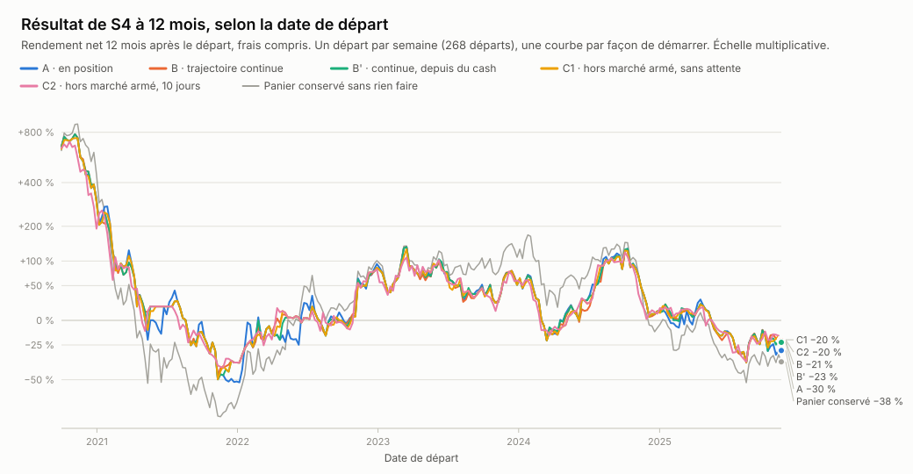
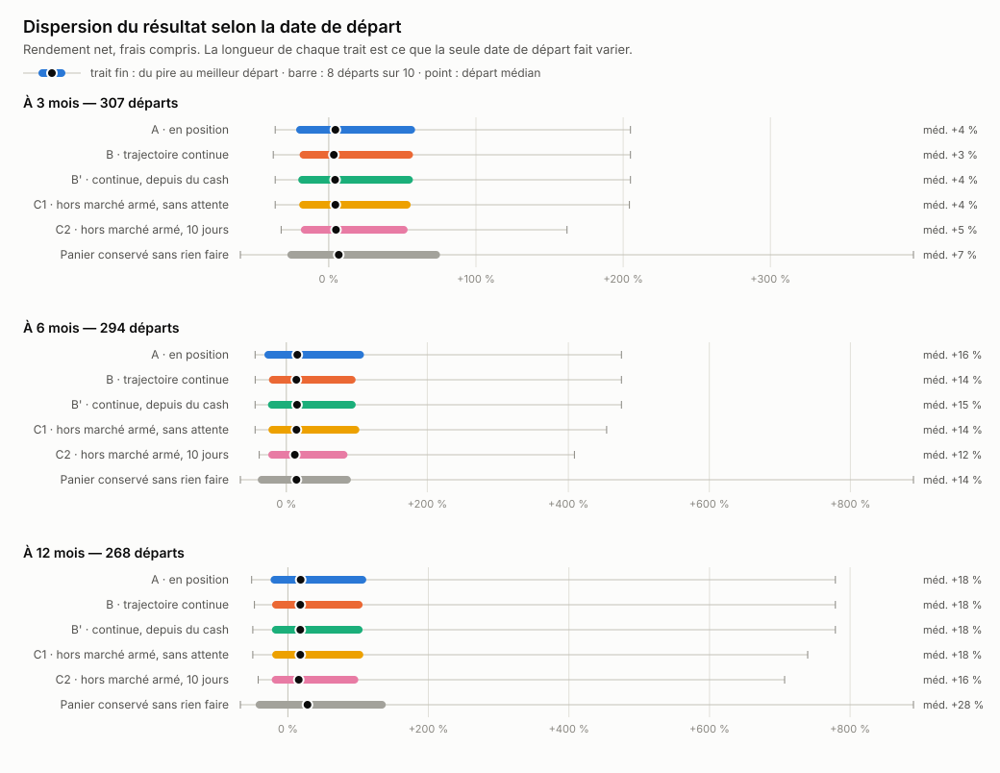
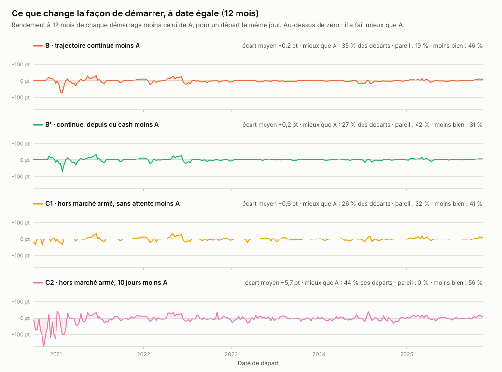
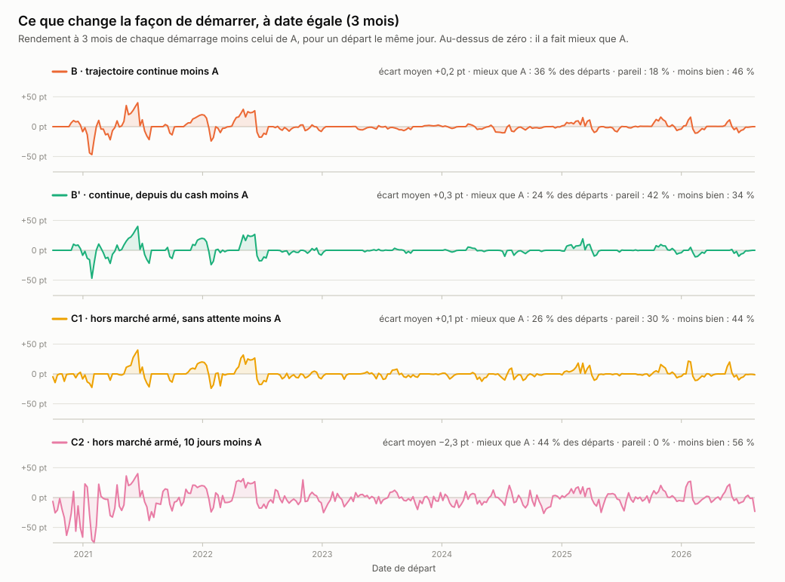
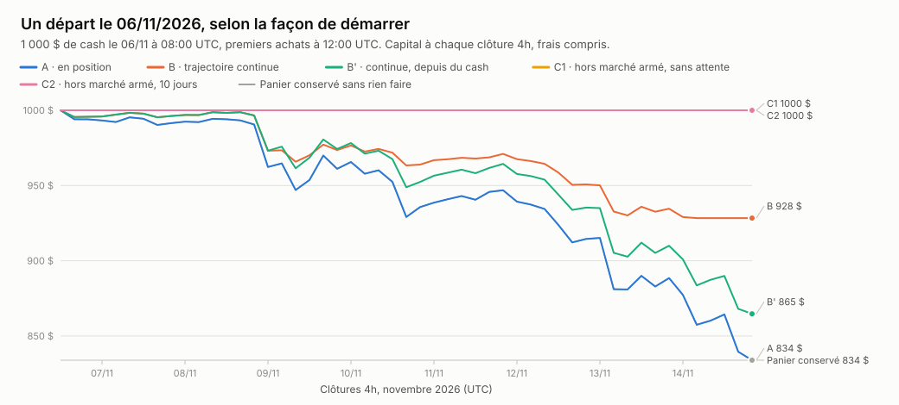

# Rapport : le résultat de S4 dépend-il du jour et de la façon dont on le démarre ?

Étude hors ligne du 14/11/2026, demandée avant tout passage en argent réel.
Chiffres et graphiques produits par `npm run bench:start`. Tableaux complets : `out/bench-start/tables.md`.

**Ce rapport décrit, il ne valide pas.** Toutes les données utilisées ont déjà servi à mettre au point ou à valider S4 (la fenêtre scellée 2024-2026 a été ouverte une fois, pour cela). Aucun paramètre n'a été cherché ni réglé. Rien n'a été modifié en production.

## En bref

1. **La date de démarrage change énormément le résultat. La façon de démarrer le change peu, et sans direction.**
   Douze mois après le départ, S4 va de −52 % à +779 % selon la date, et huit départs sur dix finissent entre −24 % et +112 %. Pour une même date, A, B, B' et C1 finissent à 5 points les uns des autres dans un cas sur deux, tantôt dans un sens, tantôt dans l'autre : en moyenne, l'écart est nul. Choisir la façon de démarrer pèse à peu près autant que décaler le départ d'une semaine.
2. **Cette dépendance à la date vient du marché, pas de S4.** Le panier conservé sans rien faire varie encore plus (de −68 % à +890 %). S4 réduit les pertes des mauvais départs, il ne les supprime pas.
3. **Démarrer hors marché (C) ne rapporte ni ne coûte rien en moyenne quand on n'attend pas.** C1 fait jeu égal avec A et B. C2, qui attend 10 jours, coûte environ 6 points de rendement moyen sur 12 mois et limite un peu mieux le pire cas.
4. **Aucune façon de démarrer ne protège d'un mauvais jour.** Les pires départs sont des sommets de marché, où tous les actifs sont au-dessus de leur moyenne 50 jours : le filtre de C laisse entrer comme les autres.
5. **Le 06/11/2026 était un cas favorable à C.** Les quatre actifs étaient sous leur moyenne : C serait resté à 1 000 $, contre 928 $ pour le démarrage fait en production et 834 $ pour un démarrage en position.
6. **Mon avis pour l'argent réel : démarrer en C1.** Pas parce qu'il rapporte plus (il ne rapporte pas plus), mais parce qu'il ne coûte rien, qu'il applique dès le premier jour la règle que S4 applique ensuite, et qu'il ne dépend d'aucun historique reconstitué. La décision revient à Julien.

## Ce qui a été comparé

Cinq façons de démarrer S4 avec 1 000 $ de cash, à une date donnée. Les règles de S4, ses seuils, ses frais et le moteur sont ceux du banc, sans aucun changement.

| | Démarrage | Ce que ça veut dire |
|---|---|---|
| **A** | En position | Les quatre lignes sont achetées tout de suite aux poids cibles. Le stop de 20 % se mesure depuis cet achat. C'est le démarrage du banc. |
| **B** | Trajectoire continue | On reprend l'état qu'aurait S4 ce jour-là s'il tournait sans interruption depuis 2020 : mêmes lignes en marché ou hors marché, mêmes plus-hauts. C'est ce qui a été fait en production le 06/11. |
| **B'** | Trajectoire continue, depuis du cash | Mêmes lignes en marché ou hors marché que B, mais le plus-haut d'une ligne achetée repart de son achat. C'est ce que ferait le code actuel en partant de cash (voir l'encadré). |
| **C1** | Hors marché armé, sans attente | Rien n'est acheté d'office. Une ligne entre dès que sa clôture est au-dessus de sa moyenne 50 jours, donc tout de suite si elle l'est déjà. |
| **C2** | Hors marché armé, 10 jours | Comme C1, mais aucune entrée pendant les 10 premiers jours. |

Et, pour information seulement, le **panier conservé sans rien faire** : acheté une fois aux poids 32,5 / 32,5 / 20 / 15, jamais retouché.

> **Pourquoi B' existe.** Le 06/11, les plus-hauts hérités de l'historique ont été conservés parce que le portefeuille détenait déjà environ 5 % de chaque actif. En partant de 100 % cash, le code de production efface le plus-haut d'une ligne qu'il ne détient pas. Un passage en argent réel partira de cash : sans changement de code, c'est B' qui se produirait, pas B.

**Dates de départ.** Un départ par semaine du 01/10/2020 au 12/11/2026, soit 320 départs par variante, chacun suivi jusqu'à la fin des données (14/11/2026 à 20:00 UTC). Un pas d'une semaine suffit parce que deux départs voisins partagent presque tout leur parcours. Un second passage, avec un départ **par jour** (1 871 départs), vérifie sur 12 mois qu'aucun pire cas ne se cache entre deux semaines.

**Mesures.** Rendement net de frais à 3, 6 et 12 mois et jusqu'à la fin des données, pire chute en cours de route, temps passé en marché.

## 1. La date de démarrage change-t-elle beaucoup le résultat ?

Oui, énormément.



Chaque point est le résultat 12 mois après un départ à cette date. Les cinq courbes de couleur montent et descendent ensemble, de plusieurs dizaines de points, et restent proches les unes des autres : c'est le premier enseignement. La courbe grise est le panier conservé.

| Résultat à 12 mois (268 départs) | Médiane | Pire départ | Meilleur départ | 8 départs sur 10 entre | Pire chute, en moyenne | Temps en marché |
|---|---:|---:|---:|---:|---:|---:|
| A · en position | +18,3 % | −51,5 % (06/01/2022) | +779,1 % (05/11/2020) | −24,5 % et +111,6 % | −36,6 % | 68 % |
| B · trajectoire continue | +17,7 % | −47,6 % (11/11/2021) | +779,1 % (05/11/2020) | −22,4 % et +106,3 % | −35,7 % | 66 % |
| B' · continue, depuis du cash | +17,7 % | −49,8 % (11/11/2021) | +779,1 % (05/11/2020) | −22,7 % et +106,3 % | −35,9 % | 67 % |
| C1 · hors marché armé, sans attente | +17,7 % | −49,8 % (11/11/2021) | +739,7 % (05/11/2020) | −22,3 % et +107,3 % | −35,9 % | 66 % |
| C2 · hors marché armé, 10 jours | +15,5 % | −42,2 % (25/11/2021) | +706,9 % (22/10/2020) | −22,9 % et +100,2 % | −35,6 % | 65 % |
| Panier conservé sans rien faire | +28,0 % | −67,5 % (18/11/2021) | +890,2 % (12/11/2020) | −45,8 % et +139,2 % | −48,0 % | 100 % |

Trois lectures.

- **Un départ sur dix perd plus de 22 à 25 % en un an**, quelle que soit la façon de démarrer. Un départ sur dix gagne plus de 100 %.
- **Décaler le départ d'un seul jour** déplace le résultat à 12 mois d'environ 2 points en médiane, et de moins de 8 à 10 points neuf fois sur dix. **Le décaler d'une semaine** le déplace de 5 à 8 points en médiane, et de moins de 22 à 29 points neuf fois sur dix. Dans le marché de fin 2020, un jour d'écart a pu faire 100 points.
- **Changer la façon de démarrer pèse autant qu'une semaine de décalage.** À date égale, l'écart entre le meilleur et le moins bon de A, B, B' et C1 est de 5 points en médiane sur 12 mois, et de moins de 18 points neuf fois sur dix.
- **Le contrôle quotidien confirme la grille hebdomadaire.** Les médianes bougent de moins de 2 points, les bornes de la fourchette de moins de 5. Le pire cas est un peu plus bas, comme attendu : −55,5 % pour A (départ du 05/01/2022), −48,3 % pour B, −50,8 % pour B' et C1, −45,6 % pour C2.



**Pourquoi la façon de démarrer pèse peu : elle s'efface.** Une trajectoire de S4 lancée à une date quelconque finit par tenir exactement les mêmes lignes qu'une trajectoire lancée en 2020. Sur les huit origines testées, cela prend entre quelques jours et moins de quatre mois. Passé ce délai, toutes les variantes font les mêmes mouvements. Ce qui reste est le petit écart pris pendant les premières semaines.

**À la fin des données**, donc sur des durées très différentes d'un départ à l'autre, S4 termine devant le panier conservé pour 86 % des départs. Aux horizons de 3 à 12 mois, le panier conservé a une moyenne plus haute et des pires cas nettement plus bas. Ces comparaisons sont données pour information.

## 2. C fait-il mieux ou moins bien que A et B ?



Chaque panneau montre le rendement d'une variante moins celui de A, pour un départ le même jour. Une ligne à zéro veut dire « même résultat ». Aucune variante ne reste durablement au-dessus ou au-dessous de zéro.

| Écart avec A à 12 mois, même date | Moyen | Médian | Pire | Meilleur | Mieux / pareil / moins bien que A |
|---|---:|---:|---:|---:|---:|
| B · trajectoire continue | −0,2 pt | 0,0 pt | −67,6 pt (28/01/2021) | +32,2 pt (17/06/2021) | 35 % / 19 % / 46 % |
| B' · continue, depuis du cash | +0,2 pt | 0,0 pt | −67,6 pt (28/01/2021) | +32,2 pt (17/06/2021) | 27 % / 42 % / 31 % |
| C1 · hors marché armé, sans attente | −0,6 pt | 0,0 pt | −39,3 pt (05/11/2020) | +32,2 pt (17/06/2021) | 26 % / 32 % / 41 % |
| C2 · hors marché armé, 10 jours | −5,7 pt | −2,9 pt | −174,6 pt (12/11/2020) | +40,0 pt (07/01/2021) | 44 % / 0 % / 56 % |

**En moyenne.**

- **C1 fait jeu égal avec A et avec B.** L'écart moyen est de −0,6 point sur 12 mois face à A, de −0,4 point face à B, et l'écart médian est nul. À 3 et 6 mois, même constat : moins de 0,3 point d'écart moyen. Jeu égal ne veut pas dire résultat identique : sur 12 mois, C1 finit à moins de 5 points de A dans 62 % des départs, il fait mieux dans 26 % des cas et moins bien dans 41 %.
- **C2 coûte.** Attendre 10 jours fait perdre 5,7 points en moyenne sur 12 mois (2,9 points en médiane), parce que les marchés qui montent n'attendent pas. C2 fait moins bien que A dans 56 % des départs.
- **Les plus grands écarts sont tous en 2020 et au premier semestre 2021**, quand le marché pouvait prendre ou perdre 50 % en quelques semaines. Pour les départs depuis juillet 2021, l'écart entre C1 et A sur 12 mois reste sous 14 points neuf fois sur dix, avec un maximum de 32 points.

**Dans les pires cas.**

| Pire départ | À 3 mois | À 6 mois | À 12 mois | À 12 mois, contrôle quotidien |
|---|---:|---:|---:|---:|
| A · en position | −36,4 % | −44,3 % | −51,5 % | −55,5 % |
| B · trajectoire continue | −37,7 % | −44,3 % | −47,6 % | −48,3 % |
| B' · continue, depuis du cash | −36,4 % | −44,3 % | −49,8 % | −50,8 % |
| C1 · hors marché armé, sans attente | −36,4 % | −44,3 % | −49,8 % | −50,8 % |
| C2 · hors marché armé, 10 jours | −32,3 % | −38,5 % | −42,2 % | −45,6 % |

- **C1 ne protège pas d'un départ sur un sommet.** À 3 et 6 mois, son pire cas est exactement celui de A (départs de juin et mars 2024). Ces jours-là, les quatre actifs étaient au-dessus de leur moyenne 50 jours, donc C1 a acheté tout de suite, comme A. À 12 mois, le pire départ de C1 est le sommet de novembre 2021 : −49,8 %.
- **C1 aide quand le marché est déjà sous sa moyenne au départ**, mais seulement à long terme. Le pire départ de A sur 12 mois (janvier 2022, −51,5 %) est de ce type. Pour les 103 départs où au plus un actif était au-dessus de sa moyenne, le pire cas à 12 mois est de −39 % pour C1, B et B', contre −52 % pour A. À 3 mois, la différence disparaît : −30 % pour C1, −29 % pour A.
- **C2 a le meilleur pire cas à tous les horizons**, de 4 à 10 points au-dessus de A. C'est le prix de ses 6 points de rendement moyen en moins.
- **B est un peu meilleur que A dans les pires cas à 12 mois** (−48 % contre −52 à −56 %), et équivalent avant.



## 3. Qu'aurait fait chaque variante en démarrant le 06/11/2026 ?



Départ avec 1 000 $ de cash le 06/11 à 08:00 UTC, premiers achats à 12:00 UTC, comme en production (ordres à 12:15). Ce jour-là, aucun des quatre actifs ne clôturait au-dessus de sa moyenne 50 jours.

| Démarrage | Capital le 14/11 à 04:00 UTC | Capital à la fin des données (14/11 à 20:00 UTC) | Rendement | Temps en marché |
|---|---:|---:|---:|---:|
| A · en position | 857,45 $ | 833,93 $ | −16,61 % | 98 % |
| B · trajectoire continue | 928,35 $ | 928,35 $ | −7,17 % | 56 % |
| B' · continue, depuis du cash | 883,61 $ | 864,74 $ | −13,53 % | 83 % |
| C1 · hors marché armé, sans attente | 1 000,00 $ | 1 000,00 $ | 0,00 % | 0 % |
| C2 · hors marché armé, 10 jours | 1 000,00 $ | 1 000,00 $ | 0,00 % | 0 % |
| Panier conservé sans rien faire | 857,45 $ | 833,93 $ | −16,61 % | 98 % |

- **Le banc retrouve la production.** B donne −7,17 %. Le pilote réel a fait −7,10 % (1 034,45 $ au départ, 961,00 $ le 14/11).
- **C n'aurait rien acheté.** Aucune ligne n'a rempli la condition d'entrée pendant la période.
- **B a mieux résisté que B' parce qu'il avait hérité de plus-hauts anciens.** Ses stops étaient proches : ETH est sorti le 09/11, BTC et BNB le 14/11. B', dont les plus-hauts repartaient de l'achat, n'a déclenché aucun stop et a subi toute la baisse sur 85 % du capital. A y ajoute XRP et la subit sur 100 %.
- **Le chiffre de 933 $ cité dans l'analyse préalable correspond à B', pas à A.** Ramené au capital du pilote (1 034,45 $) et lu le 14/11 à 00:00 UTC, B' donne 932 $ et B donne 961 $. Un vrai démarrage en position, qui achète aussi XRP, donne 908 $ au même instant. Le marché a encore baissé dans les heures suivantes, d'où les chiffres plus bas du tableau.

Huit jours et demi de données ne disent rien de la suite : C devra bien entrer un jour, et rien ne garantit qu'il le fera à meilleur prix.

## 4. Mon avis pour un passage en argent réel

**Démarrer en C1** : toutes les lignes hors marché et armées, chaque ligne entrant dès que sa clôture journalière est au-dessus de sa moyenne 50 jours.

Mes raisons, dans l'ordre :

1. **Il ne coûte rien de mesurable en moyenne.** Moins d'un point d'écart moyen avec A et B à tous les horizons, écart médian nul.
2. **C'est la règle de S4 appliquée dès le premier jour.** Aujourd'hui, S4 n'exige la moyenne 50 jours que pour racheter une ligne sortie. La première entrée est la seule qui y échappe. C1 supprime cette exception sans ajouter de paramètre.
3. **Il ne dépend d'aucun historique.** B suppose de faire confiance à des plus-hauts et à des dates de sortie issus d'une trajectoire que personne n'a tradée. Et depuis du cash, le code actuel ne fait pas B mais B', qui a perdu 13,5 % le 06/11.
4. **Il évite précisément ce qui s'est passé le 06/11** : acheter 85 % du portefeuille dans des actifs qui clôturaient 7 à 10 % sous leur moyenne.
5. **Il est un peu moins sensible au jour choisi** que A (1,7 point d'écart médian pour un jour de décalage, contre 2,5).

Ce que cet avis ne promet pas :

- **C1 ne protège pas d'un mauvais jour.** Démarrer sur un sommet coûte autant qu'avec A. Aucune variante testée n'y change quoi que ce soit. La date pèse bien plus que la méthode.
- **Les écarts entre A, B, B' et C1 n'ont pas de direction.** Pour une date donnée, C1 peut finir quelques points au-dessus ou au-dessous d'une autre variante, sans qu'on puisse le savoir d'avance. Choisir C1 est un choix de cohérence et de robustesse, pas un choix de performance.
- **C2 est l'alternative prudente** si Julien préfère limiter le pire cas : 4 à 10 points de mieux dans les pires départs, pour environ 6 points de rendement moyen en moins sur 12 mois.

Deux conséquences pratiques, quel que soit le choix :

- **Ne pas juger le démarrage sur ses premières semaines.** Le résultat de la première année dépendra surtout du marché rencontré.
- **La mise en œuvre est un chantier à part.** C1 se prépare en semant l'état de départ (lignes hors marché, armées, sortie datée d'au moins 10 jours), sans toucher aux règles. Cela reste à cadrer et à décider ; rien n'a été fait dans cette étude.

Une piste non testée : étaler l'entrée sur plusieurs semaines. Elle réduirait la dépendance au jour, mais elle introduit un nouveau réglage (la durée d'étalement), ce que ce test excluait.

## Limites

- **Descriptif, pas probant.** Toutes les bougies ont déjà été vues par S4. Ces chiffres disent ce que la règle figée aurait fait, pas ce qu'elle fera.
- **Six ans, un seul grand cycle haussier.** Les moyennes sont tirées vers le haut par les départs de fin 2020 (+600 à +800 % en un an). Les médianes et les fourchettes sont plus fiables que les moyennes.
- **320 départs ne sont pas 320 expériences.** Deux départs voisins partagent presque tout leur parcours. Il y a environ six années de marché indépendantes, pas plus.
- **B se confond avec A au tout début.** La trajectoire « continue » démarre elle-même en position le 01/10/2020. Pendant ses premiers mois, B est A par construction.
- **Un départ depuis du cash n'est pas la trajectoire continue.** S4 n'achète pas une ligne dont le régime est en cours de changement. Dans 65 % des départs, au moins une ligne attend ainsi avant d'être achetée. C'est vrai pour toutes les variantes. Pour B, cela crée un écart moyen nul avec la trajectoire continue, mais qui a atteint 30 points sur 3 mois pour un départ de novembre 2020.
- **Frais du banc** : 0,1 % de frais et 0,05 % de glissement par ordre, sur 1 000 $. Des montants réels plus élevés pourraient glisser davantage.
- **Départs à 00:00 UTC.** L'heure du départ dans la journée n'a pas été étudiée, sauf pour le 06/11 (08:00 UTC, comme en production).

## Fidélité et relance

Avant toute mesure, le script vérifie trois choses et refuse de continuer si l'une échoue :

- son harnais, semé comme le banc, redonne la trajectoire S4 du banc sur chacune des 13 415 barres 4h depuis le 01/10/2020 ;
- cette trajectoire reproduit le capital scellé publié de S4, 1 101,50 $ ;
- un démarrage B à l'instant du pilote tient exactement les lignes semées en production le 06/11 (`out/s4/reconstruction.json`).

Pour relancer :

```bash
npm run bench:start
```

Environ 16 minutes sur 8 processus. Le script lit uniquement les bougies du dépôt et n'écrit que dans `out/bench-start/` et `docs/img/demarrage-s4/`. Options : `--report-only` redessine graphiques et tableaux sans recalculer, `--refresh` retélécharge d'abord les bougies publiques récentes (seul accès réseau), `--jobs N` fixe le nombre de processus.

Données :

- `data/calibration/` : les lots certifiés, dont le lot 2024-2026 qui était scellé hors dépôt jusqu'à l'ouverture unique de la validation de S4. Il est versionné depuis cette étude et toujours vérifié octet pour octet contre l'empreinte commitée avant l'ouverture.
- `data/s4-start/live/` : les bougies publiques Binance closes depuis le 20/05/2026, épinglées par SHA-256. Leur recouvrement avec le lot certifié est vérifié bougie par bougie.

Résultats : `out/bench-start/summary.json` (agrégats), `weekly.json` (les 320 départs), `pilot.json` (le départ du 06/11), `tables.md` (tous les tableaux, dont les horizons 3 et 6 mois et le découpage par année).
